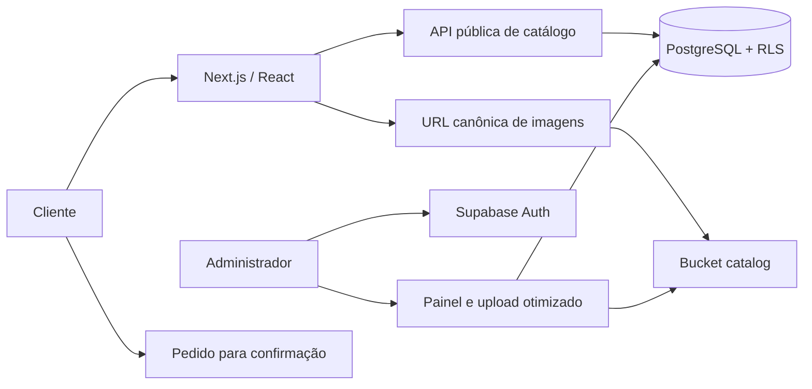
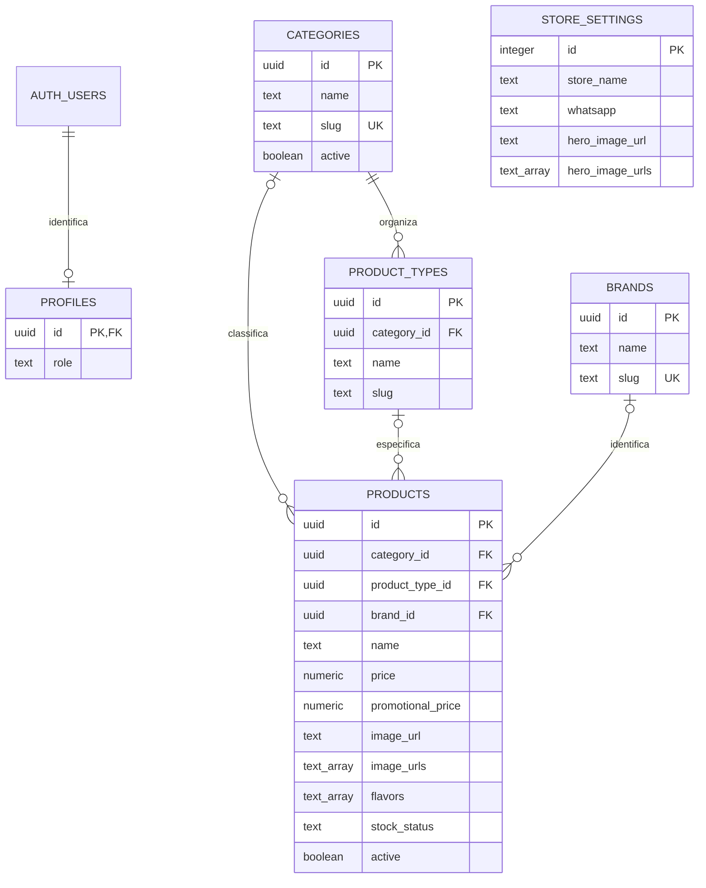

# Projeto e relações SQL

Data: 2026-11-13. @author Carla Evelyn.

## Arquitetura

Next.js 16, React 19 e TypeScript estrito executam em Node.js. O backend usa
Supabase PostgreSQL, Auth, Data API e Storage. As variáveis públicas apontam
para o projeto de cada nova loja. Não há conta compartilhada ou serviço de cloud
provisionado pelo modelo.

## Organização

| Caminho                                              | Responsabilidade                                      |
| ---------------------------------------------------- | ----------------------------------------------------- |
| `config/site.json`                                   | Identidade estática, textos e formato monetário       |
| `scripts/personalize.mjs`                            | Assistente que sincroniza identidade e SQL inicial    |
| `components/storefront.tsx`                          | Catálogo, filtros, opções, carrinho e pedido          |
| `components/admin-dashboard.tsx`                     | Administração autorizada e persistência               |
| `components/admin/`                                  | Editores de produto, taxonomia e galerias             |
| `components/hero-gallery.tsx`, `product-gallery.tsx` | Apresentação da capa e fotos do produto               |
| `components/modal.tsx`                               | Foco contido, fundo isolado, Escape e retorno de foco |
| `components/auth/`, `lib/auth/`                      | Links de recuperação, sessão e nova senha             |
| `lib/catalog-server.ts`, `lib/store.ts`              | Consulta pública e cache/deduplicação                 |
| `lib/media.ts`, `app/media/`                         | Restrição de origem e entrega otimizada               |
| `lib/images/`                                        | Conversão, hash, upload e normalização de fotos       |
| `lib/cart.ts`, `hooks/use-cart.ts`                   | Carrinho mínimo e reconciliação                       |
| `lib/contact.ts`                                     | Contato opcional e construção segura do link          |
| `supabase/schema.sql`                                | Instalação, atualização, RLS, relações e bucket       |
| `tests/`                                             | Dados artificiais e testes isolados                   |

## Modelo de dados

`store_settings` tem uma linha com id=1. A instalação cria somente essa
configuração genérica. Produtos, categorias, marcas, tipos e usuários são
cadastrados posteriormente.

`profiles.id` referencia `auth.users.id`. O papel `admin` autoriza escrita; `viewer`
não administra. Visitantes leem somente registros ativos. O bucket público
permite leitura das fotos, mas upload/alteração/exclusão exigem administração.
As políticas e FKs também validam operações feitas fora da interface.

Excluir categoria preserva seus produtos, removendo o vínculo; tipos pertencem a
uma categoria e são excluídos com ela. Excluir marca/tipo desvincula o produto.
Triggers impedem tipo de outra categoria, sincronizam nomes legados e atualizam
timestamps. Preço promocional deve ser menor que o normal. Instalações legadas
com constraints ausentes são tratadas sem apagar registros duplicados.

As listas de fotos são ordenadas e limitadas a seis; a primeira sincroniza os
campos únicos de compatibilidade. A migração é aditiva e pode ser reexecutada.
Não regrava todas as fotos legadas nem substitui configurações já existentes.

## Catálogo, pedido e cache

A API pública usa cliente anônimo sem cookies, respeitando RLS. Respostas
saudáveis têm cache de 60 segundos e SWR de 300; falhas não entram em cache e não
são substituídas por produtos inventados. Demonstração local usa catálogo vazio.

O carrinho salva somente id, opção e quantidade, com chave ligada ao identificador
da loja. Preço, marca, imagem e disponibilidade vêm do catálogo atual. Antes do
WhatsApp há nova conferência; alterações exigem revisão do pedido. O servidor
não cria pedido/reserva nem executa pagamento.

## Segurança e operação

O proxy de sessão executa somente na administração. O formulário de recuperação
é público, valida autorização no Auth e remove tokens da barra de endereço.
A senha é alterada no Supabase Auth, sem tabela própria de senhas no catálogo.
CSP restringe imagens, conexões e scripts. Somente o bucket/origem configurados
podem ser usados pela rota de mídia; ela não é um proxy aberto.

Mantenha backups do banco **e dos bytes das fotos**. Um dump SQL sozinho contém
metadados do Storage, não as imagens. O modelo não configura backups, SMTP, DNS,
pagamentos ou um servidor de produção automaticamente.
